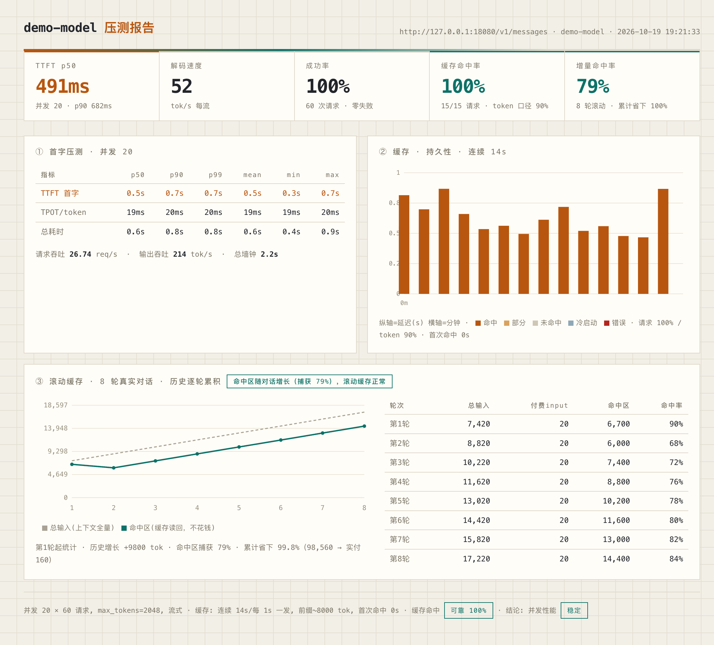
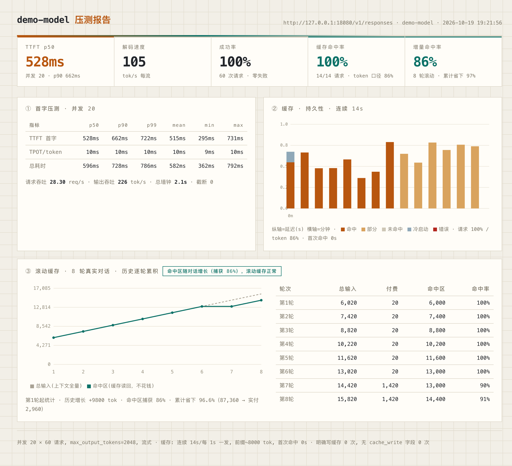
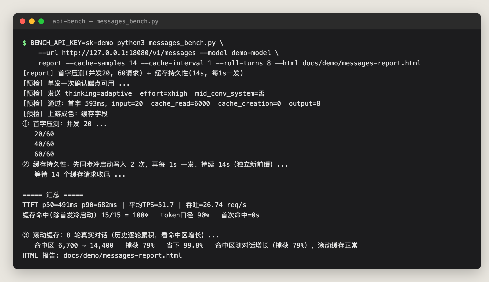
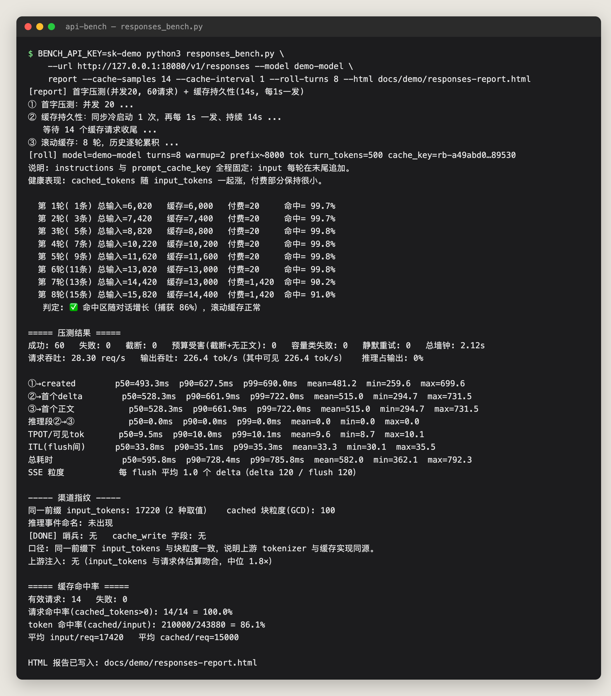

<div align="center">

# api-bench

### 测 AI API 网关的首字延迟、缓存命中和滚动缓存：两个脚本，纯标准库，一页 HTML 报告

[](LICENSE)
[](https://www.python.org)
[](#安装)
[](https://github.com/Okkmass/api-bench/pulls)

中文 | [English](#english)

</div>

---

## 这是什么

买了中转站或自建了网关，最想知道三件事：**首字够不够快、缓存到底有没有命中、长对话会不会越用越烧钱**。api-bench 用两个单文件脚本回答它们：

| 脚本 | 协议 | 典型对象 |
| --- | --- | --- |
| `messages_bench.py` | Claude `/v1/messages` | Claude 原生接口及兼容网关 |
| `responses_bench.py` | OpenAI `/v1/responses` | OpenAI Responses 接口及兼容网关 |

- **纯 Python 标准库**，不用 `pip install`，拷走就能跑（Python 3.9 与 3.14 上验证过）。
- 四种模式：`report`（一页自包含 HTML 报告，最常用）、`bench`（并发 / 限速压测）、`cache`（缓存命中率）、`roll`（滚动缓存）。
- 指标对齐 GuideLLM / LLMPerf：TTFT、TPOT、ITL、吞吐，p50 / p90 / p99。
- 密钥走环境变量，不会出现在进程列表里；报告里不含密钥。

## 预览

> 以下截图来自仓库自带的模拟上游（`examples/mock_upstream.py`），是**演示数据**，不是任何真实站点的结果。

**Messages 报告**（`report` 模式生成的 HTML）



**Responses 报告**



**终端输出**

| Messages | Responses |
| :---: | :---: |
|  |  |

报告文件见 [`docs/demo/`](docs/demo/)，是单个 HTML，浏览器直接打开。

## 安装

```bash
git clone https://github.com/Okkmass/api-bench.git
cd api-bench
python3 messages_bench.py --help
```

不需要装任何依赖，也可以只下载你要用的那一个脚本。

## 快速开始

```bash
# 密钥用环境变量传，不要写进命令行
export BENCH_API_KEY=sk-xxxx

# 一页 HTML 报告：首字压测 + 缓存持久性 + 滚动缓存
python3 messages_bench.py \
    --url https://你的网关/v1/messages --model claude-sonnet-4-5 \
    report --concurrency 20 --html report.html

# OpenAI Responses 协议
python3 responses_bench.py \
    --url https://你的网关/v1/responses --model gpt-5 \
    report --concurrency 20 --html report.html
```

`report` 默认的缓存阶段约 320 秒（40 发 × 8 秒）。想先快速看一眼，缩短它：

```bash
python3 messages_bench.py --url ... --model ... \
    report --cache-samples 14 --cache-interval 1 --roll-turns 8 --html report.html
```

### 四种模式

| 模式 | 作用 | 示例 |
| --- | --- | --- |
| `report` | 一页 HTML：首字压测 + 缓存持久性 + 滚动缓存 | `report --concurrency 20 --html r.html` |
| `bench` | 并发 / 限速压测，可导出 CSV / JSON | `bench --concurrency 10 --requests 50 --csv out.csv` |
| `cache` | 同一大前缀连发 N 次，看缓存命中率 | `cache --rounds 5` |
| `roll` | 多轮对话、历史逐轮累积，看命中区是否随对话长大 | `roll --turns 12` |

注意：`--prefix-tokens`、`--model`、`--profile` 等是**全局参数，要写在子命令之前**：

```bash
python3 messages_bench.py --url ... --model ... --prefix-tokens 8000 cache --rounds 5
```

### Messages 的请求画像

`--profile claude-code`（默认）按 Claude Code 的请求形态发包；`--profile generic` 发通用 Messages 请求，不带 Claude Code 专用头和 system 块，适合测非 Claude 的兼容网关。

### 指标口径

- **TTFT**：请求发出到第一个输出 token。
- **TPOT**：（总耗时 − TTFT）/（输出 token 数 − 1）。
- **ITL**：相邻流式 chunk 的间隔。
- **缓存命中率**：排除首发冷启动后 `cache_read > 0` 的请求占比；**token 命中率** = Σcache_read / Σ 总输入。
- **滚动缓存**：命中区能否随对话变长一起增长，用「捕获率」和「累计省下」衡量。

完整参数见各脚本的 `--help`。

## 本地没有可测的网关？用模拟上游

```bash
python3 examples/mock_upstream.py 18080 &
export BENCH_API_KEY=anything
python3 messages_bench.py --url http://127.0.0.1:18080/v1/messages --model demo-model \
    report --cache-samples 14 --cache-interval 1 --roll-turns 8 --html demo.html
```

模拟上游会模拟前缀缓存命中、滚动缓存增长和首字抖动，用来试跑脚本、看报告长什么样、做 CI 冒烟。

## 在线版

不想本地跑？OkkMax 提供了同一套脚本的在线版：**<https://www.okkmax.com/tools/api-speed>**，填网关地址和密钥即可，结果可分享。本仓库是它的命令行版，可以在自己的机器或服务器上运行，数据不经过第三方。

## 安全

- 优先用环境变量 `BENCH_API_KEY`（`responses_bench.py` 也认 `OPENAI_API_KEY`）。`--token` 只为兼容保留，会出现在进程列表里。
- 生成的 HTML / JSON / CSV 里不包含密钥，但包含你的网关地址，分享前请自行确认。
- 压测会产生真实请求并**消耗额度**，缓存和滚动缓存测试会发送较长的上下文，先小规模试跑。
- 请只测试你有权测试的接口。

## 许可

[MIT](LICENSE) © Okkmass

---

## English

api-bench is two single-file, **stdlib-only** Python scripts that benchmark AI API gateways: time-to-first-token (TTFT), throughput, **prompt-cache hit rate**, and **rolling-cache growth** across long conversations.

| Script | Protocol |
| --- | --- |
| `messages_bench.py` | Claude `/v1/messages` |
| `responses_bench.py` | OpenAI `/v1/responses` |

```bash
export BENCH_API_KEY=sk-xxxx

# self-contained HTML report: TTFT under concurrency + cache persistence + rolling cache
python3 messages_bench.py --url https://your-gateway/v1/messages --model <model> \
    report --concurrency 20 --html report.html

python3 responses_bench.py --url https://your-gateway/v1/responses --model <model> \
    report --concurrency 20 --html report.html
```

Modes: `report` (HTML report), `bench` (concurrency / rate-limited load test, CSV/JSON export), `cache` (cache hit rate), `roll` (rolling cache). Global options such as `--model` and `--prefix-tokens` go **before** the subcommand. The default cache phase of `report` takes about 320 s; use `--cache-samples 14 --cache-interval 1 --roll-turns 8` for a quick run. No dependencies; verified on Python 3.9 and 3.14.

No gateway at hand? `python3 examples/mock_upstream.py 18080` starts a mock upstream that simulates prefix-cache hits and rolling-cache growth; the screenshots above were generated against it and are demo data only.

A hosted version of the same scripts is available at <https://www.okkmax.com/tools/api-speed>. Pass the key via `BENCH_API_KEY` rather than `--token` so it does not appear in the process list. Benchmarks send real requests and consume quota; only test endpoints you are authorized to test.

MIT licensed.
